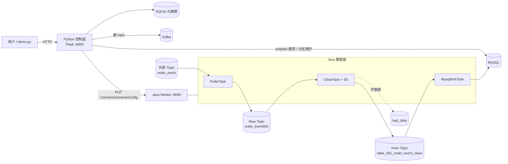

# mini-databus

这是 BK-BASE“队列接入 → 数据清洗 → MySQL 入库”链路的学习版，按 `queue_access_to_clean_design.md` 实现。和原平台一样分成两部分（文档 3.5.2 控制面与数据面分离）：

- **Python 控制面**（对应 `src/api/datahub`）：提供接入、清洗、入库接口，保存元数据，建 topic、建表，生成任务配置并下发。
- **Java 数据面**（对应 `src/datahub/databus`）：一个简化的 Kafka Connect Worker，真正搬运和处理数据，负责高吞吐。

两边只通过 REST 接口和配置键名约定交互，和原平台 Python 调 Kafka Connect REST 的方式一样。

## 架构



## 目录

```
control-plane/            控制面（Python）
  app.py                   接口层：/v3/access/...、/v3/databus/...、/v3/storekit/...
  access.py                接入：参数校验、Raw Data、Raw Topic、Puller 配置     文档 5.2、6、7
  clean.py                 清洗配置、分区校验、Clean 任务配置                   文档 8、9
  storage.py               添加入库、MysqlShipper 配置（JDBC URL 等）            文档 18.5、18.7
  storekit.py              MySQL 建表、加列、分区维护                           文档 18.6、18.11
  worker.py                调用 Java Worker REST，记录任务状态
  kafka_admin.py           建 topic、查分区、扩分区
  meta_db.py               元数据表                                             文档 4
  settings.py              配置（都可用环境变量覆盖）
  demo.py                  端到端演示
data-plane/               数据面（Java）
  Worker.java              进程入口 + REST 接口（模拟 Kafka Connect Worker）
  Connector.java           一个 connector = tasks.max 个任务线程，失败自动重启
  BaseTask.java            任务模板：poll -> process -> flush -> 提交 offset   文档 9.7
  PullerTask.java          外部 Kafka -> Raw Topic                             文档 7.8
  CleanTask.java           Raw Topic -> ETL -> Avro 打包 -> inner Topic         文档 9.8
  Etl.java                 规则树引擎                                           文档 10
  AvroCodec.java           Avro + Snappy 编解码                                 文档 11
  MysqlSinkTask.java       inner Topic -> JDBC 批量写入 MySQL                   文档 18.8
  Kafkas.java、Metrics.java  Producer 参数、指标
```

建议阅读顺序：先看 `control-plane/access.py → clean.py → storage.py`，了解配置是怎么生成和下发的；再看 `data-plane/BaseTask → PullerTask → CleanTask → Etl → MysqlSinkTask`，了解数据是怎么流动的。

## 运行

需要 Python 3.9+、JDK 11+、Maven，以及 Kafka 和 MySQL（可以用 `docker compose up -d` 启动）。

```bash
# 1. 启动 Java 数据面
cd data-plane && mvn -q package && java -jar target/mini-databus.jar

# 2. 启动 Python 控制面（另开一个终端）
cd control-plane && pip install -r requirements.txt && python app.py

# 3. 端到端演示：创建接入、清洗、入库，灌 10 万条订单，观察 MySQL 行数（另开一个终端）
cd control-plane && python demo.py 100000
```

地址默认是 `localhost:9092`（Kafka）、`127.0.0.1:3306`（MySQL，root/root123）、`localhost:8083`（Worker）。用 `OUTER_KAFKA`、`MYSQL_HOST`、`WORKER_URL` 等环境变量修改，完整列表见 [settings.py](control-plane/settings.py)。

`demo.py` 只能运行一次，因为数据源和结果表重名会被拒绝。要重来，就删掉 `control-plane/meta.db` 和 `data-plane/connectors.json`，再删掉 MySQL 里的 `mapleleaf_591` 库。

## 接口

| 接口 | 作用 |
| --- | --- |
| `POST /v3/access/deploy_plan/` | 创建接入，并启动 Puller |
| `PUT/GET /v3/access/deploy_plan/{raw_data_id}/` | 更新或查看接入（返回时密码脱敏） |
| `POST /v3/databus/cleans/` | 创建清洗配置（不启动） |
| `PUT/GET /v3/databus/cleans/{rt_id}/` | 更新或查看清洗配置；运行中的任务会重新下发 |
| `POST /v3/databus/scenarios/setup_clean/` | 创建清洗配置并启动 |
| `POST /v3/databus/tasks/` | 启动任务，`storages` 取 `kafka`（清洗）和/或 `mysql`（入库） |
| `DELETE /v3/databus/tasks/{rt_id}/?storages=kafka,mysql` | 停止任务 |
| `GET /v3/databus/tasks/` | 任务列表，附带 Worker 中的实时状态和指标 |
| `POST /v3/databus/data_storages/` | 添加 MySQL 入库：登记、建表、启动任务 |
| `DELETE /v3/databus/data_storages/{rt_id}/` | 删除入库，表改名为 `_to_delete` |
| `GET /v3/storekit/mysql/{rt_id}/prepare/`、`.../maintain/`、`/v3/storekit/mysql/maintain_all/` | 建表补字段、分区维护 |

Java Worker 的接口：`GET /connectors`、`GET /connectors/{name}`、`PUT /connectors/{name}/config`、`DELETE /connectors/{name}`。

## 吞吐和可靠性

- **批量**：Consumer 一次拉 2000 条；Producer 用 `linger.ms` 和 256KB 批次攒批，并做 lz4 压缩；清洗结果每 100 行打成一条 Avro + Snappy 消息；MySQL 用 `rewriteBatchedStatements=true`，把每 2000 行合并成多值 INSERT 并提交一次事务。
- **并行**：每个 connector 启动 `tasks.max` 个线程，都在同一个消费组里，Kafka 按分区把数据分给它们。控制面把 `tasks.max` 设成源 topic 的分区数，要提高吞吐就加分区（`TOPIC_PARTITIONS`）。Java 没有 GIL，线程可以用满多核。
- **背压**：Producer 缓冲满了 `send()` 会阻塞等待，不会丢数据，也不会撑爆内存。
- **至少一次**：三类任务都是“下游写成功后再提交 offset”（`BaseTask.java`）。任务失败会在 5 秒后重启，从上次提交的位置重放。需要去重时开启 `has_unique_key`，用 `ON DUPLICATE KEY UPDATE` 写入。

## 与原平台的差异

| 原平台 | 本项目 |
| --- | --- |
| Django + DRF + MySQL 元数据库 | Flask + SQLite |
| MetaApi 存结果表字段 | 存在 `databus_clean.fields` |
| Kafka Connect 分布式 Worker | 单进程 Worker，配置存在 `connectors.json` |
| Java 任务启动时调 API 拉 RT 配置 | 字段和清洗规则直接放进 connector 配置 |
| ZooKeeper 通知热更新 | 更新清洗配置时重新下发，Worker 重启任务 |
| Celery 异步启动入库、celery-beat 分区维护 | 同步启动；API 进程里的线程每天维护一次 |
| Kafka Puller 自动提交 offset（文档 L4） | 改成发送成功后手动提交 |
| broker 只支持单个地址（文档 L2） | 支持逗号分隔多个地址 |
| 按错误信息字符串分类 SQL 异常 | 按 MySQL 错误码和 SQLState 分类 |
| 支持 Pulsar 通道、Redis offset、启动阶段先删后写 | 未实现 |
