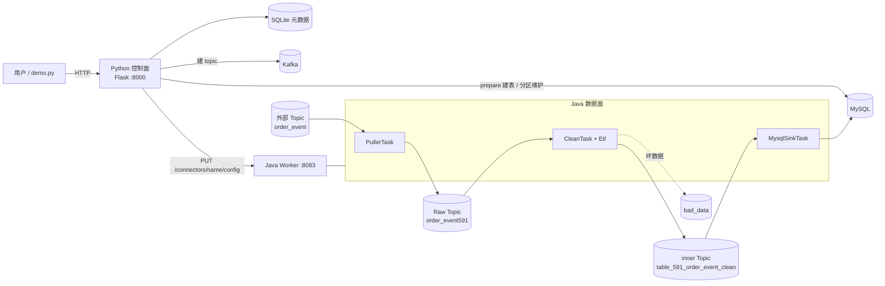

# mini-databus

这是 BK-BASE“队列接入 → 数据清洗 → MySQL 入库”链路的学习版，按 `queue_access_to_clean_design.md` 实现。和原平台一样分成两部分（文档 3.5.2 控制面与数据面分离）：

- **Python 控制面**（对应 `src/api/datahub`）：提供接入、清洗、入库接口，保存元数据，建 topic、建表，生成任务配置并下发。
- **Java 数据面**（对应 `src/datahub/databus`）：一个简化的 Kafka Connect Worker，真正搬运和处理数据，负责高吞吐。

两边只通过 REST 接口和配置键名约定交互，和原平台 Python 调 Kafka Connect REST 的方式一样。

## 架构



## 目录

```
control-plane/            控制面（Python）
  app.py                   接口层：/v3/access/...、/v3/databus/...、/v3/storekit/...
  access.py                接入：参数校验、Raw Data、Raw Topic、Puller 配置     文档 5.2、6、7
  clean.py                 清洗配置、分区校验、Clean 任务配置                   文档 8、9
  storage.py               添加入库、MysqlShipper 配置（JDBC URL 等）            文档 18.5、18.7
  storekit.py              MySQL 建表、加列、分区维护                           文档 18.6、18.11
  worker.py                调用 Java Worker REST，记录任务状态
  kafka_admin.py           建 topic、查分区、扩分区
  meta_db.py               元数据表                                             文档 4
  settings.py              配置（都可用环境变量覆盖）
  demo.py                  端到端演示
data-plane/               数据面（Java）
  Worker.java              进程入口 + REST 接口（模拟 Kafka Connect Worker）
  Connector.java           一个 connector = tasks.max 个任务线程，失败自动重启
  BaseTask.java            任务模板：poll -> process -> flush -> 提交 offset   文档 9.7
  PullerTask.java          外部 Kafka -> Raw Topic                             文档 7.8
  CleanTask.java           Raw Topic -> ETL -> Avro 打包 -> inner Topic         文档 9.8
  Etl.java                 规则树引擎                                           文档 10
  AvroCodec.java           Avro + Snappy 编解码                                 文档 11
  MysqlSinkTask.java       inner Topic -> JDBC 批量写入 MySQL                   文档 18.8
  Kafkas.java、Metrics.java  Producer 参数、指标
```

建议阅读顺序：先看 `control-plane/access.py → clean.py → storage.py`，了解配置是怎么生成和下发的；再看 `data-plane/BaseTask → PullerTask → CleanTask → Etl → MysqlSinkTask`，了解数据是怎么流动的。

## 运行（Linux 完整步骤）

以 TencentOS / CentOS / RHEL 为例，使用 `root` 用户，除特别说明外命令都在**项目根目录**执行。整体需要 3 个终端：

| 终端 | 进程 | 端口 |
| --- | --- | --- |
| A | Java 数据面 Worker | 8083 |
| B | Python 控制面 API | 8000 |
| C | 演示脚本 / 验证命令 | - |

Kafka（9092）和 MySQL（3306）由 Docker 在后台运行。

### 第 1 步：安装依赖软件

| 软件 | 版本要求 | 用途 |
| --- | --- | --- |
| Docker + Compose 插件 | Compose v2 | 运行 Kafka 3.8、MySQL 8.0 |
| JDK | **8 及以上** | 编译、运行数据面 |
| Maven | 3.6+ | 构建数据面，自动下载 Java 依赖 |
| Python | **3.6 及以上** | 运行控制面 |

代码按以下最低环境适配：JDK 1.8.0_392、Maven 3.6.3、Python 3.6.8、Docker 24.0.6。

```bash
# JDK（必须带 -devel，才有 javac）、Maven、Python
dnf install -y java-1.8.0-openjdk-devel maven python3 python3-pip

# Docker Engine + Compose 插件
dnf install -y dnf-plugins-core
dnf config-manager --add-repo https://download.docker.com/linux/centos/docker-ce.repo
dnf install -y docker-ce docker-ce-cli containerd.io docker-compose-plugin
systemctl enable --now docker
```

Ubuntu / Debian 把 `dnf` 换成 `apt`，包名为 `openjdk-8-jdk maven python3 python3-venv python3-pip`，Docker 参考 [官方文档](https://docs.docker.com/engine/install/)。

### 第 2 步：检查环境

```bash
docker --version && docker compose version
java -version        # 1.8 及以上
mvn -v               # 输出中的 Java version 是 1.8 及以上
python3 --version    # 3.6 及以上
```

`mvn -v` 显示的 Java 版本和 `java -version` 不一致时，用 `JAVA_HOME` 指定：`export JAVA_HOME=/usr/lib/jvm/java-1.8.0-openjdk`（路径以 `ls -d /usr/lib/jvm/*` 为准）。

### 第 3 步：启动 Kafka 和 MySQL

```bash
docker compose up -d
docker compose ps    # kafka、mysql 两个容器都是 running
```

MySQL 首次启动需要十几秒初始化，等下面的命令输出 `mysqld is alive` 再继续：

```bash
docker compose exec mysql mysqladmin ping -uroot -proot123
```

### 第 4 步：构建并启动 Java 数据面（终端 A）

```bash
cd data-plane
mvn -q package                       # 首次会从 Maven 中央仓库下载依赖，产物 target/mini-databus.jar
java -jar target/mini-databus.jar    # 前台运行，监听 :8083
```

另开终端确认 Worker 已启动（返回 `[]` 或 connector 列表即正常）：

```bash
curl -s localhost:8083/connectors
```

### 第 5 步：安装依赖并启动 Python 控制面（终端 B）

```bash
cd control-plane
python3 -m venv .venv
source .venv/bin/activate
pip install -U "pip<22"              # Python 3.6 自带的 pip 太旧，装不了 confluent-kafka 的预编译包
pip install -r requirements.txt      # flask、requests、confluent-kafka、PyMySQL（已固定为支持 3.6 的版本）
python app.py                        # 前台运行，监听 :8000
```

国内网络 pip 慢可以加镜像：`pip install -r requirements.txt -i https://mirrors.cloud.tencent.com/pypi/simple`。

### 第 6 步：运行端到端演示（终端 C）

```bash
cd control-plane
source .venv/bin/activate
python demo.py 100000                # 参数为订单条数，默认 100000
```

脚本依次执行：

1. 创建外部 topic `order_event`（模拟业务方的 Kafka）
2. 创建接入，启动 Puller：`order_event` → Raw Topic `order_event591`
3. 创建清洗配置并启动 Clean：Raw Topic → `table_591_order_event_clean`
4. 添加 MySQL 入库，自动建表 `mapleleaf_591.order_event_clean_591` 并启动入库任务
5. 向 `order_event` 灌入指定条数的订单
6. 每 2 秒打印一次 MySQL 行数和写入速度，最后输出各任务状态与指标

### 第 7 步：验证结果

```bash
curl -s localhost:8083/connectors           # Worker 中运行的 connector
curl -s localhost:8000/v3/databus/tasks/    # 任务列表、状态和指标
docker compose exec mysql mysql -uroot -proot123 \
  -e "SELECT COUNT(*) FROM mapleleaf_591.order_event_clean_591"
```

每条订单包含多个商品，清洗时会展开成多行，所以 MySQL 行数比订单数多。

### 第 8 步：全部重置，从头开始

> **提醒**：`demo.py` 只能成功运行一次，再次运行会因为数据源和结果表重名被拒绝。
> 另外，Worker 启动时会按 `connectors.json` 恢复旧任务，`meta.db` 也会保留旧的接入和清洗记录；
> 如果 Kafka / MySQL 被重建过而这两个文件还在，就会出现 `UNKNOWN_TOPIC_OR_PARTITION`、topic 只有 1 个分区、库表不存在等状态不一致的问题。
> 所以每次重跑，都按下面的顺序**全部清理后再启动**。

**1. 全部清理**（项目根目录执行）

```bash
./reset.sh
```

脚本 [reset.sh](reset.sh) 依次执行：结束占用 8083 / 8000 端口的 Worker 和 API 进程（先正常结束，10 秒未退出再强制结束）→ 删除 `control-plane/meta.db`、`data-plane/connectors.json` → `docker compose down -v` 删除 Kafka、MySQL 容器及数据。端口释放失败会报错退出。

<details>
<summary>等价的手动命令</summary>

```bash
fuser -k 8083/tcp 8000/tcp
ss -lntp | grep -E ':8083|:8000'     # 没有输出才算清理干净
rm -f control-plane/meta.db data-plane/connectors.json
docker compose down -v
```

</details>

**2. 重新启动基础环境**

```bash
docker compose up -d
sleep 20
docker compose ps                                          # kafka、mysql 都是 running
docker compose exec mysql mysqladmin ping -uroot -proot123 # 输出 mysqld is alive 再继续
```

**3. 终端 A：启动 Java 数据面**

```bash
cd data-plane
mvn -q package
java -jar target/mini-databus.jar
```

看到 `Worker 已启动，REST 端口 8083` 即成功。由于已删除 `connectors.json`，不应再出现“恢复 connector”日志。

**4. 终端 B：启动 Python 控制面**

```bash
cd control-plane
source .venv/bin/activate
python app.py
```

看到 `Running on http://0.0.0.0:8000/` 且没有 Traceback 即成功。

**5. 终端 C：运行演示**

```bash
cd control-plane
source .venv/bin/activate
python demo.py 100000
```

第 1、2、3 步都应返回 `-> 200 {"result": true, ...}`，之后开始灌数据并每 2 秒打印行数。

**6. 验证**

```bash
docker compose exec mysql mysql -uroot -proot123 -e "SELECT COUNT(*) FROM mapleleaf_591.order_event_clean_591"
```

**只想停止环境、不再运行时**：在终端 A、B 按 `Ctrl+C`，再执行 `docker compose down`（加 `-v` 同时清空数据）。

### 常见问题

| 现象 | 原因 | 处理 |
| --- | --- | --- |
| `invalid flag: --release` | 用的是旧版 `pom.xml` | 拉取最新代码，`pom.xml` 已改为 `source/target 1.8` |
| `mvn: command not found` | 未安装 Maven | `dnf install -y maven` |
| `pip install confluent-kafka` 编译失败、找不到 `librdkafka` | pip 太旧，没用上预编译包 | 先执行 `pip install -U "pip<22"` 再装 |
| `pip install` 报找不到匹配版本 | 没用项目里的 `requirements.txt` | 按 `requirements.txt` 安装，它已固定为支持 Python 3.6 的版本 |
| `demo.py` 报连接 8000/8083 失败 | API 或 Worker 没启动 | 检查终端 A、B 的进程和日志 |
| `demo.py` 报连接 MySQL 失败 | MySQL 未初始化完 | 用 `mysqladmin ping` 确认后重试 |
| `demo.py` 报名称已存在 | 已运行过一次 | 按第 8 步全部重置 |
| `Address already in use` / `BindException` | 旧的 API 或 Worker 进程还在运行 | `ss -lntp \| grep -E ':8083\|:8000'` 查 pid 后 `kill`，或 `fuser -k 8083/tcp 8000/tcp` |
| Worker 日志 `UNKNOWN_TOPIC_OR_PARTITION`、只分到 `xxx-0` 分区 | Kafka 被重建过，但 `connectors.json` / `meta.db` 还是旧的 | 按第 8 步全部重置 |
| `Unknown database 'mapleleaf_591'` | demo 第 3 步“添加入库”失败，没有建库 | 看 demo 第 3 步输出和终端 B 日志，修复后按第 8 步重置 |
| `'cryptography' package is required ...` | MySQL 8 默认认证需要 `cryptography` | `pip install -r requirements.txt`（已包含），或 `pip install "cryptography>=3.4,<41"` |
| `CryptographyDeprecationWarning: Python 3.6 ...` | 仅提示 Python 3.6 将不再被支持 | 可忽略，不影响运行 |
| 端口被占用 | 9092/3306/8083/8000 已被使用 | 停掉占用进程，或用下方环境变量改端口 |

### 配置

地址默认是 `localhost:9092`（Kafka）、`127.0.0.1:3306`（MySQL，root/root123）、`localhost:8083`（Worker）、`localhost:8000`（API），都可以用环境变量修改：

| 变量 | 默认值 | 作用 |
| --- | --- | --- |
| `OUTER_KAFKA` / `INNER_KAFKA` | `localhost:9092` | Raw Topic / 清洗结果所在 Kafka |
| `MYSQL_HOST` / `MYSQL_PORT` / `MYSQL_USER` / `MYSQL_PASSWORD` | `127.0.0.1` / `3306` / `root` / `root123` | 入库 MySQL |
| `WORKER_URL` | `http://localhost:8083` | 控制面调用的 Worker 地址 |
| `WORKER_PORT` / `WORKER_STATE_FILE` | `8083` / `connectors.json` | Worker 监听端口、配置持久化文件 |
| `TOPIC_PARTITIONS` | `6` | 新建 topic 分区数，即最大并发度 |
| `API_PORT` | `8000` | 控制面端口 |

完整列表见 [settings.py](control-plane/settings.py)。

## 接口

| 接口 | 作用 |
| --- | --- |
| `POST /v3/access/deploy_plan/` | 创建接入，并启动 Puller |
| `PUT/GET /v3/access/deploy_plan/{raw_data_id}/` | 更新或查看接入（返回时密码脱敏） |
| `POST /v3/databus/cleans/` | 创建清洗配置（不启动） |
| `PUT/GET /v3/databus/cleans/{rt_id}/` | 更新或查看清洗配置；运行中的任务会重新下发 |
| `POST /v3/databus/scenarios/setup_clean/` | 创建清洗配置并启动，可带 `consume_position` |
| `POST /v3/databus/tasks/` | 启动任务，`storages` 取 `kafka`（清洗）和/或 `mysql`（入库）；清洗可带 `consume_position` |
| `DELETE /v3/databus/tasks/{rt_id}/?storages=kafka,mysql` | 停止任务 |
| `GET /v3/databus/tasks/` | 任务列表，附带 Worker 中的实时状态和指标 |
| `POST /v3/databus/data_storages/` | 添加 MySQL 入库：登记、建表、启动任务 |
| `DELETE /v3/databus/data_storages/{rt_id}/` | 删除入库，表改名为 `_to_delete` |
| `GET /v3/storekit/mysql/{rt_id}/prepare/`、`.../maintain/`、`/v3/storekit/mysql/maintain_all/` | 建表补字段、分区维护 |

Java Worker 的接口：`GET /connectors`、`GET /connectors/{name}`、`PUT /connectors/{name}/config`、`DELETE /connectors/{name}`。

### 清洗任务的两种启动方式（consume_position）

| 取值 | 行为 | 控制面动作 |
| --- | --- | --- |
| `continue`（默认） | 从上次停止的位置继续消费，停止期间积压的数据会被补齐；从未消费过时从头开始 | 无 |
| `tail` | 忽略停止期间的数据，从**调用接口时刻** Raw Topic 的末尾开始消费 | 先停止清洗任务，再把消费组 `connect-clean-{rt_id}` 在 Raw Topic 各分区的 offset 提交为 LEO |

和原平台一样，Java 侧没有新增参数：控制面在下发任务之前，修改 `CleanTask` 启动时读取的消费组位点。原平台的 Kafka 方案是往结果 topic 写一条标记消息，本项目没有这样做，下游因此不会收到空 value 消息。`tail` 会自动先停止运行中的任务，所以对运行中的任务传 `tail` 也会生效。被跳过的数据不会自动补回。

```bash
curl -s -XPOST localhost:8000/v3/databus/tasks/ -H 'Content-Type: application/json' \
  -d '{"result_table_id": "591_order_event_clean", "storages": ["kafka"], "consume_position": "tail"}'
```

## 吞吐和可靠性

- **批量**：Consumer 一次拉 2000 条；Producer 用 `linger.ms` 和 256KB 批次攒批，并做 lz4 压缩；清洗结果每 100 行打成一条 Avro + Snappy 消息；MySQL 用 `rewriteBatchedStatements=true`，把每 2000 行合并成多值 INSERT 并提交一次事务。
- **并行**：每个 connector 启动 `tasks.max` 个线程，都在同一个消费组里，Kafka 按分区把数据分给它们。控制面把 `tasks.max` 设成源 topic 的分区数，要提高吞吐就加分区（`TOPIC_PARTITIONS`）。Java 没有 GIL，线程可以用满多核。
- **背压**：Producer 缓冲满了 `send()` 会阻塞等待，不会丢数据，也不会撑爆内存。
- **至少一次**：三类任务都是“下游写成功后再提交 offset”（`BaseTask.java`）。任务失败会在 5 秒后重启，从上次提交的位置重放。需要去重时开启 `has_unique_key`，用 `ON DUPLICATE KEY UPDATE` 写入。

## 与原平台的差异

| 原平台 | 本项目 |
| --- | --- |
| Django + DRF + MySQL 元数据库 | Flask + SQLite |
| MetaApi 存结果表字段 | 存在 `databus_clean.fields` |
| Kafka Connect 分布式 Worker | 单进程 Worker，配置存在 `connectors.json` |
| Java 任务启动时调 API 拉 RT 配置 | 字段和清洗规则直接放进 connector 配置 |
| ZooKeeper 通知热更新 | 更新清洗配置时重新下发，Worker 重启任务 |
| Celery 异步启动入库、celery-beat 分区维护 | 同步启动；API 进程里的线程每天维护一次 |
| Kafka Puller 自动提交 offset（文档 L4） | 改成发送成功后手动提交 |
| broker 只支持单个地址（文档 L2） | 支持逗号分隔多个地址 |
| 按错误信息字符串分类 SQL 异常 | 按 MySQL 错误码和 SQLState 分类 |
| 支持 Pulsar 通道、Redis offset、启动阶段先删后写 | 未实现 |
